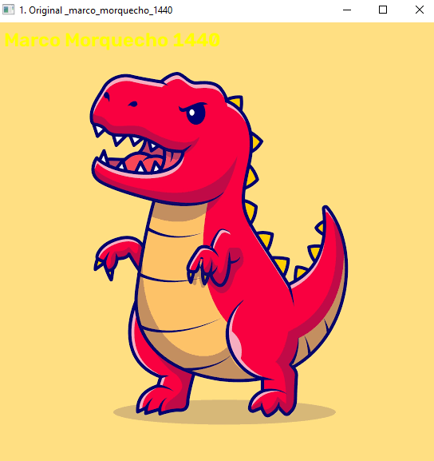
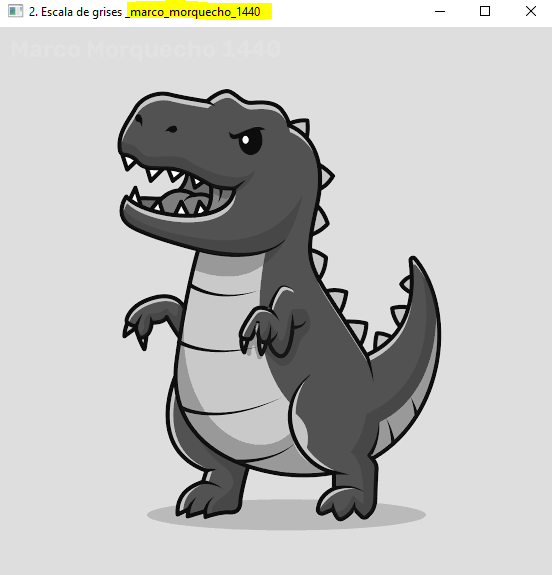
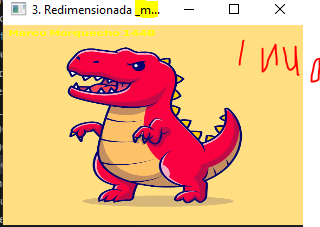
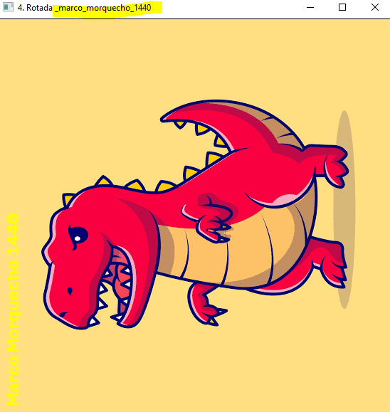
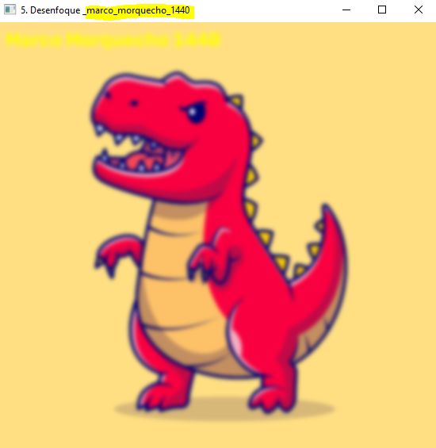
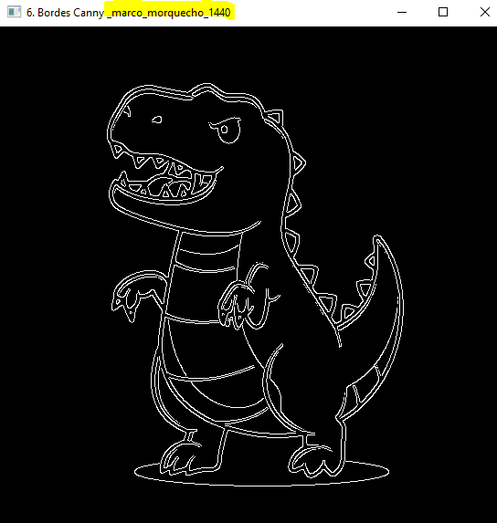
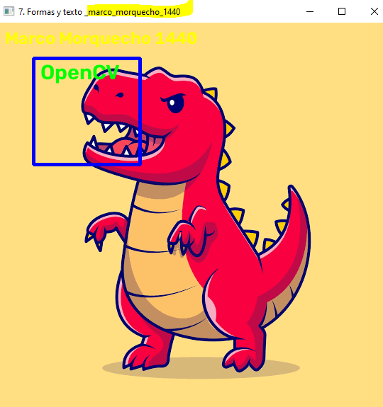
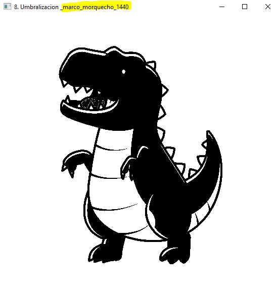
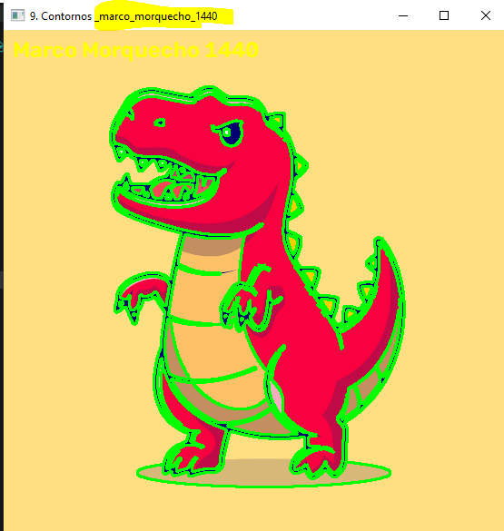

## 2.1 Ejemplo de código

## 3.1 Ejemplo de código: Convertir una imagen a escala de grises

## 4.1 Ejemplo de código: Cambiar el tamaño de la imagen

## 5.1 Ejemplo de código: Girar la imagen 90 grados.

## 6. Desenfoque de una imagen

## 7. Detección de bordes mediante el algoritmo de Canny

## 8. Dibujar formas y añadir texto

## 9. Umbralización

## 10. Detección de contornos
